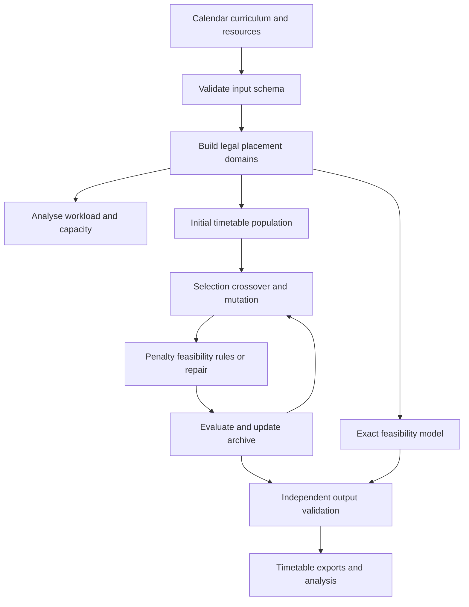

# Intelligent Timetable for University

## Project overview

**Intelligent Timetable for University**, implemented under the research name **OffDayOpt**, is a Python and Jupyter Notebook project for generating and evaluating university teaching timetables. It uses evolutionary search, explicit constraint handling and an independent mixed-integer feasibility model to assign required class meetings to suitable periods and rooms.

The project addresses a practical scheduling problem: different programmes and sections have different weekly-off days, while lecturers and teaching spaces are shared. A timetable must preserve those calendars, avoid clashes and accommodate all required meetings. Among valid timetables, the system searches for arrangements with fewer student gaps, less concentrated daily teaching and more consistent room allocation.

All research implementation is contained in two Jupyter notebooks. Supporting Python scripts execute and verify the notebooks; they do not contain a separate scheduling engine.

## Teaching calendar

The reference calendar runs from **Monday to Saturday**, between **09:30 and 15:30**, with a protected lunch break from **12:30 to 13:30**.

| Slot | Teaching time |
| --- | --- |
| 1 | 09:30–10:30 |
| 2 | 10:30–11:30 |
| 3 | 11:30–12:30 |
| Lunch | 12:30–13:30, excluded from scheduling |
| 4 | 13:30–14:30 |
| 5 | 14:30–15:30 |

Each event occupies one teaching slot. A room or lecturer therefore has 30 potential weekly periods before additional availability restrictions are applied. Cohorts have fewer available periods when their weekly-off rules are considered.

The protected lunch interval is removed from the decision space. The algorithms cannot assign a meeting to lunch because it is not represented as a teaching slot.

## Dataset and provenance

The reference benchmark contains:

| Component | Size |
| --- | --- |
| Student cohorts | 16 |
| Distinct module codes | 18 |
| Cohort-module offerings | 50 |
| Required one-hour meetings | 150 |
| Lecture-type meetings | 107 |
| Laboratory meetings | 43 |
| Synthetic students | 509 |
| Synthetic lecturers | 18 |
| Lecture rooms | 5, each with 45 seats |
| Laboratories | 3, each with 40 seats |

Module mappings and cohort weekly-off rules come from the supplied planning information. **Contact hours, enrolment sizes, lecturer assignments and room inventory are synthetic assumptions**, rather than verified institutional records.

Each cohort-module offering has three assumed weekly meetings. Most offerings contain two lecture meetings and one laboratory meeting. MATU9S1, MGTU7S1 and CSCU9Z7 use three lecture, tutorial or project-supervision meetings. Project independent study is outside the model. All supplied modules are scheduled; the implementation does not infer elective alternatives.

DS&AI Year 2 Sections A and B inherit the Tuesday and Friday off rule. CS Year 3 and SE Year 3 SQA use explicitly approved provisional availability on all six days because their weekly-off rules were not supplied. These calendars remain provisional in the dataset and documentation.

CSCU9P5 and CSCU9E5 retain their distinct supplied codes, although both have the title Software Engineering I. Separate meetings are retained for sections sharing a module; the implementation does not automatically merge them into combined lectures.

## Notebook architecture

### Notebook 01 — Complete project

`notebooks/01_OffDayOpt_Complete_Project.ipynb` contains the full configurable implementation:

1. Environment and experiment configuration.
2. Input loading and embedded fallback data.
3. Dataset schema validation.
4. Legal placement-domain construction.
5. Capacity and workload analysis.
6. Independent timetable validation.
7. Fitness calculation and repair.
8. Five stochastic search variants.
9. Exact feasibility modelling.
10. Repeated experiments and conditional analysis.
11. Timetable selection and exports.
12. Visualisations and resource sensitivity.
13. Regression and adversarial tests.
14. Reconciliation of the preserved manuscript results.

### Notebook 02 — Manuscript reproduction

`notebooks/02_Manuscript_Reproduction.ipynb` embeds the original study implementation. It reads the preserved input and result files, validates the recorded selected timetable and plots the original conditional quality distributions.

The original 30-seed timed study can be rerun by setting `REPRODUCE_TIMED_STUDY=True`. New rerun results are saved separately. Host-dependent stopping means that a timed rerun is not expected to reproduce every recorded score exactly.

The new notebook implementation and the original manuscript study are deliberately identified as separate experiments. Enhancements in Notebook 01 are not presented as retrospective evidence for the original study.

## Processing workflow



The diagram summarises the architecture. Exact feasibility and stochastic search run as separate methods. The exact solution does not initialise the evolutionary population. If no stochastic run returns a feasible schedule, a validated exact witness may be used as an explicitly labelled fallback for timetable display; the failed stochastic runs remain failures in the experiment results.

## Input representation

The primary editable input is `data/instance.json`. It defines the calendar, modules, cohorts, lecturers, rooms and required events.

Each event identifies its cohort, module, lecturer and required room type. Every event has a unique identifier. Cohorts include enrolment size and weekly-off days. Lecturers and rooms can include additional unavailable periods.

Availability entries use a day name and a **zero-based teaching-slot index**. For example, `["Monday", 0]` blocks Monday’s first teaching period. The lunch interval has no slot index.

The main notebook also embeds the complete reference dataset as a fallback. This allows the primary notebook to run independently when the external JSON file is unavailable.

## Legal placement domains

Before search begins, `build_domains()` constructs the permitted time-room assignments for every event. A placement is included only when:

- Its day is available to the cohort.
- Its period is a valid teaching slot.
- The assigned lecturer is available.
- The room is available.
- The room type matches the meeting requirement.
- The room capacity accommodates the cohort.

Domain filtering prevents variation operators from creating several classes of invalid assignment. However, two events may still choose the same lecturer, cohort or room at the same time. These shared-resource conflicts require further handling.

A valid dataset can have an event with no legal placement. This is mathematical infeasibility, distinct from a malformed input file. Empty-domain diagnostics identify the affected event rather than silently dropping it.

## Chromosome representation

A candidate timetable is a sequence with one gene per required event. Each gene stores a legal flattened time index and a room index.

The time index is calculated as:

```text
time_index = day_index × teaching_slots_per_day + slot_index
```

This compact representation supports crossover, mutation and resource-conflict counting. Export functions convert the indices into readable days, time intervals, rooms and lecturers.

An assignment must remain associated with its original input snapshot: changing the room ordering while retaining old room indices would change its meaning.

## Hard constraints and independent validation

A complete valid timetable must assign every required event exactly once and avoid cohort, lecturer and room clashes. It must also satisfy the availability, room-type and capacity restrictions represented by the domains.

The search fitness counts remaining shared-resource clashes as conflicting pairs. For a resource-period occupied by `k` meetings, the contribution is `k(k−1)/2`. Their sum is the hard-conflict count **H**.

`validate_records()` independently checks the returned schedule against the input records. It detects missing, duplicate and unknown events; malformed assignments; invalid time or room indices; weekly-off violations; unavailable lecturers or rooms; unsuitable room types; insufficient seats; and shared-resource clashes.

Bounds are checked before indices are used. A low fitness value is not accepted as a substitute for validation. An invalid candidate is never exported as an ordinary validated timetable.

## Soft quality objective

Among feasible timetables, the project evaluates:

```text
S = 3G + 2O + M + R
```

| Component | Meaning |
| --- | --- |
| G | Empty teaching periods between a cohort’s first and last daily class |
| O | Cohort-day contact hours above four |
| M | Meetings beyond the first for the same cohort and module on one day |
| R | Distinct rooms above two for a cohort-module offering |

Lunch is excluded from the gap calculation. A class ending at 12:30 followed by one starting at 13:30 does not create an avoidable teaching gap.

The weights are experimental preferences. They are not validated measures of student satisfaction or learning outcomes. A timetable can satisfy every hard constraint while retaining a positive soft penalty.

## Implemented search methods

| Method | Implementation |
| --- | --- |
| Random repair | Samples independent legal chromosomes, repairs them and retains the best evaluated result |
| Static-penalty GA | Selects population members using `λH + S`, with configurable λ and default value 100 |
| Feasibility-first GA | Compares `(H, S)` lexicographically without repair |
| Lamarckian-repair GA | Repairs a candidate and stores the repaired representation for subsequent variation |
| Baldwinian-repair GA | Evaluates a repaired copy while retaining the original genotype |

Every method maintains a separate archive ordered by `(H, S)`. The archive retains the evaluated phenotype, including for Baldwinian search, so the returned assignment corresponds to the schedule that actually received the recorded score.

### Genetic operators

The default population contains 24 candidates. Binary tournament selection chooses parents. Uniform crossover selects each event assignment from either parent with equal probability.

Mutation resamples a legal assignment independently for each gene with probability `min(1, 2/n)`, where `n` is the number of events. The expected mutation count is configurable.

The algorithm uses steady-state replacement. A better child replaces the worst population member. Otherwise, a three-percent random admission probability can replace a randomly selected member. The separate archive preserves the best evaluated result.

These are documented starting settings, not parameters established as optimal through a tuning study.

### Scarcity-guided repair

Repair processes events with fewer legal placements first, using random tie ordering. For each event, it tries the inherited assignment before considering randomly ordered legal alternatives. It accepts the first placement that does not clash with already placed events of the same cohort, lecturer or room.

If no immediate conflict-free placement exists, the inherited assignment is retained and residual conflicts remain visible in the outcome. Repair terminates but does not guarantee feasibility. Coordinated swaps or backtracking may be necessary for more difficult instances.

## Exact feasibility model

The project uses SciPy’s `milp()` interface to HiGHS for an independent binary feasibility model. Each variable represents a legal event-time-room assignment.

The model requires exactly one assignment per event and at most one simultaneous event for each cohort, lecturer and room. Explicit room domains support heterogeneous capacities and room unavailability.

The objective is zero. A validated solution establishes feasibility; it does **not** establish the minimum soft penalty. Solver time limits and infeasibility statuses are distinguished. Failure to find an incumbent before a time limit is reported as unknown rather than automatically declared infeasible.

## Experiment configuration and reproducibility

The quick profile uses three seeds per method and 200 complete candidate evaluations per run. With five methods, it generates 15 fresh outcomes. The paper profile uses 30 seeds and an approximately one-second budget per method. Custom settings support other budgets and population parameters.

All methods receive the same seed-specific initial portfolio, then use separate random streams. Notebook 01 shuffles method execution order per seed to reduce fixed-order timing bias.

Fixed-evaluation experiments reproduce the candidate sequence and objective values under a compatible implementation. Timed experiments depend on hardware and runtime conditions. Initialisation is included, but the initial population is completed before stopping, so time limits are soft.

Repair probes are recorded separately from complete fitness evaluations. Equal evaluation counts do not imply equal primitive computational work.

Each execution creates a fresh timestamped output directory containing the input snapshot, configuration, input hash, environment information, run records, final assignments and improvement traces. Preserved manuscript files are not overwritten.

## Analysis, visualisations and exports

The notebooks produce capacity comparisons, daily cohort teaching-load heatmaps, feasible-return rates, conditional soft-score distributions and room-resource sensitivity results.

Success rates use every run. Soft quality is summarised only among feasible outcomes, with the feasible sample count retained. Bootstrap intervals are omitted when fewer than five feasible results are available. Run-level intervals describe stochastic variability for the same workload; they do not establish generalisation to other institutions.

Exports include event-level CSV timetables, validated assignment JSON, HTML cohort timetable grids, detailed validation reports, raw experiment records, summary tables and PNG visualisations. HTML output escapes input labels.

## Preserved research results

`paper_results/` contains the original four-method study with 30 runs per method, totalling 120 outcomes. It is separate from the newer five-method notebook experiments.

| Original method | Feasible runs | Median soft penalty among feasible runs |
| --- | --- | --- |
| Random repair | 30/30 | 151.0 |
| Static-penalty GA | 1/30 | 117.0, based on one outcome |
| Lamarckian repair | 30/30 | 135.5 |
| Baldwinian repair | 30/30 | 149.5 |

The recorded selected timetable has `H=0` and `S=113`. These are conditional results for one constructed workload. They do not establish general superiority over other timetabling algorithms.

Resource checks also established that four lecture rooms and two labs suffice under the reference assumptions. The corresponding exact witnesses are retained. This does not imply that the reduced-room schedule has minimum soft penalty or that actual institutional rooms can be removed.

## Testing and execution status

Notebook 01 contains 11 regression and adversarial tests covering reference counts, protected lunch intervals, duplicate input identifiers, malformed output records, unavailable resources, capacity restrictions, weekly-off violations, incorrect room types, impossible overlaps, fixed-budget reproducibility, archive consistency and failure reporting.

All 19 Python code cells across both notebooks passed shared-namespace execution verification, and all 11 tests passed. Local verification did not use a real Jupyter kernel because that environment lacked the Jupyter execution packages.

`tools/run_with_jupyter.py` provides actual notebook-format validation and Jupyter execution after dependencies are installed. The GitHub Actions workflow is configured for Python 3.11 and 3.12; hosted CI execution has not yet been verified.

## Installation and use

From the repository root, install the dependencies and register the kernel:

```bash
python -m pip install -r requirements.txt
python -m ipykernel install --user --name offdayopt --display-name "OffDayOpt"
python -m jupyterlab
```

Open the main notebook, choose the OffDayOpt kernel and run all cells from a fresh kernel. Edit `data/instance.json` to change the input, and use the configuration cell to select an experiment profile.

To execute both notebooks through Jupyter:

```bash
python tools/run_with_jupyter.py --timeout 900
```

## Alignment with CSCU9YE

Unit 4 is implemented through candidate representation, populations, selection, crossover, mutation, replacement and the exploration-exploitation balance.

Unit 5 is implemented through constrained formulation, hard and soft requirements, penalties, feasibility-first comparison, repair, Lamarckian and Baldwinian inheritance, repeated experiments, computation-cost reporting and careful interpretation of uncertainty.

The project therefore supports research-based teaching as well as an inspectable scheduling case study.

## Current limitations and extensions

The current implementation assumes fixed cohorts and independent one-hour meetings. It does not enforce contiguous multi-hour laboratories, individual elective enrolments across cohorts, room travel times, lecturer rest-day policies, multiple lecturers per event or minimum-change reactive rescheduling.

These are potential extensions rather than completed features. Operational use requires approved contact-hour requirements, actual enrolments, verified lecturer availability and an accurate room inventory. No institutional deployment or measured educational benefit is claimed.
